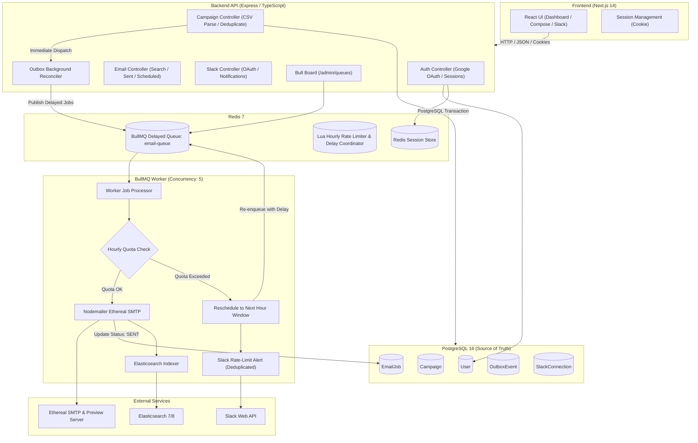

# ReachInbox Full-Stack Email Job Scheduler

A distributed, production-grade email campaign scheduler and delivery platform built for the **ReachInbox Software Development Intern** hiring assignment.

---

## 1. Project Overview

The **ReachInbox Email Job Scheduler** enables users to compose email campaigns, upload recipient lists (via CSV or text), schedule staggered email delivery to future times, and monitor queue execution with real-time delivery status, Ethereal test inbox previews, distributed hourly rate limiting, Slack notifications, and live BullMQ dashboard monitoring.

### Core Highlights
* **Deterministic delayed scheduling** using BullMQ backed by persistent Redis.
* **Transactional Outbox Pattern** ensuring zero lost jobs between PostgreSQL commits and Redis queue additions.
* **Distributed atomic hourly rate limiting** enforced across parallel workers using Redis Lua scripts.
* **Automatic job rescheduling** when an hourly sending limit is reached—jobs are never dropped or marked as failed.
* **Nodemailer + Ethereal SMTP integration** with auto-provisioned test accounts and clickable email preview links.
* **Real Google OAuth 2.0** login with secure server-side session cookies.
* **Real Slack OAuth 2.0 integration** with hourly quota exhaustion notifications and notification deduplication.
* **Elasticsearch search integration** with graceful PostgreSQL fallback.
* **Protected Bull Board queue monitoring dashboard** at `/admin/queues`.
* **Restart recovery & idempotency** tested and verified to ensure pending jobs survive server crashes and are never sent twice.

---

## 2. Feature List

- **Authentication**: Real Google OAuth 2.0 flow, server-side session cookies (`httpOnly`, `sameSite`, `secure`), and an Evaluator Demo Login for instant local testing without waiting for external Google credentials.
- **Campaign Composer**:
  - Email subject and HTML body.
  - Drag-and-drop CSV / TXT upload with RFC 4180 parsing (`csv-parse`).
  - Intelligent email column detection (supports any column header: `email`, `email_address`, `contact`, etc.).
  - Automatic recipient deduplication within the campaign.
  - Invalid email detection and reporting.
  - Live count badges for Valid, Duplicate, and Invalid recipients.
  - Start date/time picker (Local and UTC formatted).
  - Configurable minimum inter-email delay (`delayBetweenEmailsMs`).
  - Configurable maximum emails per hour quota (`hourlyLimit`).
- **Live Dashboard**:
  - Top navigation with user avatar, name, email, and logout.
  - Scheduled Emails tab: view scheduled, queued, and sending emails.
  - Sent Emails tab: view delivered emails with one-click **"Preview Email"** links opening actual Ethereal rendered HTML messages.
  - Campaigns overview tab: view progress bars (`sentCount / totalRecipients`), throttling rules, and one-click campaign cancellation.
  - Search bar powered by Elasticsearch with instant PostgreSQL fallback.
  - Live Slack integration status pill and test notification trigger.
- **Worker & Rate Limiting**:
  - Configurable worker concurrency (`WORKER_CONCURRENCY=5`).
  - Minimum delay coordination per sender across workers using Redis atomic slots.
  - Hourly rate limiting via atomic Redis Lua script (`ratelimit:hourly:{sender}:{window}`).
  - Non-blocking Slack notification delivery deduplicated to 1 alert per sender per hour.
- **Observability & Monitoring**:
  - Bull Board dashboard mounted on `/admin/queues` showing active, waiting, delayed, completed, and failed jobs.
  - Structured logging with request IDs, job IDs, and SMTP preview links.
  - `/api/health` and `/api/health/ready` checking PostgreSQL, Redis, and Elasticsearch.

---

## 3. Technology Stack

### Backend
* **Runtime**: Node.js v22+
* **Language**: TypeScript (strict mode enabled)
* **Framework**: Express.js
* **Queue & Scheduler**: BullMQ v5 backed by Redis (ioredis)
* **Database & ORM**: PostgreSQL 16+ with Prisma ORM
* **SMTP Transport**: Nodemailer with Ethereal Email test capture
* **Validation**: Zod schema validation
* **Authentication**: Google OAuth 2.0 (`google-auth-library`) & `express-session` with Redis store (`connect-redis`)
* **Integrations**: Slack OAuth 2.0 (`@slack/web-api`), Elasticsearch official JS client (`@elastic/elasticsearch`)
* **Queue Dashboard**: Bull Board (`@bull-board/express`, `@bull-board/api`)
* **Testing**: Vitest & Supertest (20 automated integration and unit tests)

### Frontend
* **Framework**: Next.js 14 (App Router)
* **Language**: React 18 & TypeScript
* **Styling**: Tailwind CSS
* **Icons**: Lucide React
* **Toasts**: Sonner
* **API Client**: Native `fetch` with credentials (`credentials: 'include'`)

### Infrastructure
* **Containerization**: Docker Compose (PostgreSQL, Redis, Elasticsearch)

---

## 4. Architecture Diagram



---

## 5. Folder Structure

```
outbox/
├── docker-compose.yml              # PostgreSQL, Redis, Elasticsearch services
├── .gitignore                      # Excludes node_modules, .env, build artifacts
├── README.md                       # Comprehensive documentation
├── backend/
│   ├── prisma/
│   │   ├── schema.prisma           # Prisma models (User, Sender, Campaign, EmailJob, etc.)
│   │   └── migrations/             # Applied database migrations
│   ├── src/
│   │   ├── app.ts                  # Express app, middleware, CORS, session, routes
│   │   ├── server.ts               # HTTP bootstrap, startup checks, graceful shutdown
│   │   ├── worker-runner.ts        # Standalone BullMQ worker process runner
│   │   ├── config/
│   │   │   ├── env.ts              # Zod environment variable validation
│   │   │   ├── logger.ts           # Pino structured logger
│   │   │   ├── prisma.ts           # PrismaClient singleton
│   │   │   └── redis.ts            # ioredis connections
│   │   ├── middleware/
│   │   │   ├── auth.middleware.ts  # Session validation & authenticated request context
│   │   │   └── error.middleware.ts # Global API error handler
│   │   ├── utils/
│   │   │   ├── crypto.ts           # AES-256-GCM token encryption & decryption
│   │   │   └── csv.ts              # RFC 4180 CSV parser & intelligent column detector
│   │   ├── integrations/
│   │   │   ├── google/oauth.ts     # Google OAuth 2.0 authorization & profile verification
│   │   │   ├── email/ethereal.ts   # Ethereal SMTP transport & preview URL generator
│   │   │   ├── slack/client.ts     # Slack OAuth 2.0 & rate-limit notification alerts
│   │   │   └── elasticsearch/client.ts # Elasticsearch mapping, indexing, and search
│   │   ├── queues/
│   │   │   └── email.queue.ts      # BullMQ queue with deterministic job IDs
│   │   ├── services/
│   │   │   ├── rate-limiter.service.ts # Redis Lua distributed rate limiter
│   │   │   └── outbox.service.ts   # Transactional Outbox crash-recovery dispatcher
│   │   ├── workers/
│   │   │   └── email.worker.ts     # Concurrency-safe BullMQ worker
│   │   ├── controllers/            # Thin REST controllers
│   │   └── routes/                 # Express versioned routers
│   ├── tests/                      # Automated Vitest integration test suites
│   ├── package.json
│   ├── tsconfig.json
│   └── .env.example
└── frontend/
    ├── src/
    │   ├── app/
    │   │   ├── layout.tsx          # Root layout with Sonner Toaster
    │   │   ├── page.tsx            # Auth redirection
    │   │   ├── login/page.tsx      # Google OAuth & Evaluator demo login
    │   │   └── dashboard/page.tsx  # Full interactive scheduling dashboard
    │   ├── components/
    │   │   ├── layout/Navbar.tsx   # Header matching Figma design
    │   │   ├── compose/ComposeModal.tsx # Recipient upload, CSV stats, schedule controls
    │   │   └── dashboard/
    │   │       ├── ScheduledTable.tsx # Scheduled emails view
    │   │       ├── SentTable.tsx      # Sent emails view with Ethereal preview links
    │   │       ├── CampaignsTable.tsx # Campaign overview & progress
    │   │       └── SlackModal.tsx     # Slack connection manager
    │   ├── lib/api.ts              # Centralized API fetch client with credentials
    │   └── types/index.ts          # TypeScript interfaces
    ├── package.json
    ├── tsconfig.json
    └── tailwind.config.js
```

---

## 6. Prerequisites

- **Node.js**: v20 or v22+
- **npm**: v10+
- **PostgreSQL**: Local service on port 5432 or Docker container
- **Redis**: Local service on port 6379 or Docker container
- **Docker & Docker Compose** (Optional for containerized infrastructure)

---

## 7. Installation Instructions

### Step 1: Clone the repository
```bash
git clone <repository_url>
cd outbox
```

### Step 2: Install Backend Dependencies
```bash
cd backend
npm install
```

### Step 3: Install Frontend Dependencies
```bash
cd ../frontend
npm install
```

---

## 8. Docker Startup Instructions

To start PostgreSQL, Redis, and Elasticsearch using Docker Compose:

```bash
docker compose up -d
```

Verify that all three containers are healthy:
```bash
docker compose ps
```

---

## 9. Database Migration Instructions

In the `backend` directory, apply the Prisma database migrations:

```bash
cd backend
npx prisma migrate dev
```

This creates the PostgreSQL tables: `User`, `Sender`, `Campaign`, `EmailJob`, `SlackConnection`, `OutboxEvent`, and `QuotaNotificationState`.

---

## 10. Running the Application

### 1. Start the Backend API & Scheduler
In the `backend` directory:
```bash
cd backend
npm run dev
```
* Backend API runs on: `http://localhost:5000`
* Protected Bull Board queue monitor: `http://localhost:5000/admin/queues`
* Health check: `http://localhost:5000/api/health`

### 2. (Optional) Run Worker as Standalone Process
To run worker concurrency in a separate process:
```bash
cd backend
npm run worker
```

### 3. Start the Frontend Dashboard
In a separate terminal, start the Next.js frontend:
```bash
cd frontend
npm run dev
```
* Frontend dashboard runs on: `http://localhost:3000`

---

## 11. Google OAuth 2.0 Configuration

1. Visit [Google Cloud Console](https://console.cloud.google.com/).
2. Create a project and navigate to **APIs & Services > Credentials**.
3. Create an **OAuth 2.0 Client ID** (Web application).
4. Add Authorized redirect URI:
   ```
   http://localhost:5000/api/auth/google/callback
   ```
5. Copy the Client ID and Client Secret into `backend/.env`:
   ```env
   GOOGLE_CLIENT_ID="your-client-id.apps.googleusercontent.com"
   GOOGLE_CLIENT_SECRET="your-client-secret"
   GOOGLE_CALLBACK_URL="http://localhost:5000/api/auth/google/callback"
   ```

> **Evaluation Shortcut**: If external Google Cloud credentials are not configured, clicking **"Sign in as Hiring Evaluator"** on the login page instantly provisions a fully authenticated session for local testing.

---

## 12. Email SMTP Setup (Real SMTP & Ethereal Fallback)

The application supports both **real production SMTP delivery** (e.g., Gmail App Passwords, SendGrid, Amazon SES) and **automatic Ethereal test inbox provisioning**.

### Option A: Real SMTP (e.g. Gmail)
1. Enable 2-Step Verification on your Google Account.
2. Go to [Google App Passwords](https://myaccount.google.com/apppasswords) and generate a 16-character App Password (select app name "ReachInbox Scheduler").
3. In `backend/.env`, configure:
   ```env
   SMTP_HOST="smtp.gmail.com"
   SMTP_PORT=587
   SMTP_USER="your-email@gmail.com"
   SMTP_PASS="xxxx-xxxx-xxxx-xxxx"   # 16-character Google App Password
   SMTP_FROM="ReachInbox Scheduler <your-email@gmail.com>"
   ```
4. Verify your configuration with the built-in test-send API or in the dashboard:
   - Authenticated endpoint: `POST /api/emails/test-send`
   - Returns `{ success: true, provider: 'real', messageId: '...', smtpVerified: true }`

### Option B: Automatic Ethereal Fallback (Zero Setup)
- If `SMTP_USER` and `SMTP_PASS` are left empty, the server automatically generates a fresh Ethereal test account on startup via `nodemailer.createTestAccount()`.
- Delivered messages generate an **Ethereal Preview URL** (e.g., `https://ethereal.email/message/...`), stored in PostgreSQL and displayed as clickable preview links in the Sent Emails tab.

---

## 13. Slack OAuth 2.0 Configuration

1. Create a Slack App at [https://api.slack.com/apps](https://api.slack.com/apps).
2. Under **OAuth & Permissions**, add Redirect URL:
   ```
   http://localhost:5000/api/auth/slack/callback
   ```
3. Add Bot Scopes:
   - `chat:write`
   - `channels:read`
   - `incoming-webhook`
4. Copy Client ID and Secret into `backend/.env`:
   ```env
   SLACK_CLIENT_ID="your-slack-client-id"
   SLACK_CLIENT_SECRET="your-slack-client-secret"
   SLACK_CALLBACK_URL="http://localhost:5000/api/auth/slack/callback"
   ```
5. Click **"Connect Slack"** in the ReachInbox top navigation to authorize your workspace.

### Rate-Limit Notification Deduplication
When an hourly rate limit is hit, the application posts an alert to Slack. To prevent alert storms (e.g., when 1,000 emails are queued), the system uses the `QuotaNotificationState` model to enforce that **at most 1 notification is sent per sender per hourly window**.

---

## 14. Elasticsearch Configuration

Elasticsearch is used for multi-field full-text search across recipients, subjects, body text, and sender identities.

In `backend/.env`:
```env
ELASTICSEARCH_URL="http://127.0.0.1:9200"
```

- When Elasticsearch is running, emails are automatically indexed under the `reachinbox_emails` index.
- If Elasticsearch is offline or memory-constrained in local development, search **gracefully falls back to PostgreSQL ILIKE queries**, ensuring uninterrupted usability.

---

## 15. Protected Bull Board Queue Monitor

Bull Board provides a visual dashboard for the `email-queue`:
- Accessible at: **`http://localhost:5000/admin/queues`**
- **Authentication**: Protected by server-side session authentication. Unauthenticated requests are rejected.

---

## 16. API Documentation

| Method | Endpoint | Description | Auth Required |
|---|---|---|---|
| `GET` | `/api/health` | Service liveness probe | No |
| `GET` | `/api/health/ready` | Readiness check (Postgres, Redis, ES) | No |
| `GET` | `/api/auth/google` | Initiates Google OAuth consent | No |
| `GET` | `/api/auth/google/callback` | Exchanges code & sets session cookie | No |
| `POST` | `/api/auth/dev-login` | Hiring evaluator instant session | No |
| `GET` | `/api/auth/me` | Returns current user profile & senders | Yes |
| `POST` | `/api/auth/logout` | Destroys session & clears cookie | Yes |
| `POST` | `/api/campaigns/parse-recipients` | Validates CSV/TXT & returns stats | Yes |
| `POST` | `/api/campaigns` | Creates campaign & schedules emails | Yes |
| `GET` | `/api/campaigns` | Lists user campaigns with pagination | Yes |
| `POST` | `/api/campaigns/:id/cancel` | Cancels pending campaign jobs | Yes |
| `GET` | `/api/emails/scheduled` | Paginated list of scheduled/queued emails | Yes |
| `GET` | `/api/emails/sent` | Paginated list of sent emails with preview URLs | Yes |
| `GET` | `/api/emails/search?q=...` | Elasticsearch search with fallback | Yes |
| `GET` | `/api/auth/slack` | Initiates Slack OAuth flow | Yes |
| `GET` | `/api/auth/slack/callback` | Slack OAuth callback & token encryption | Yes |
| `GET` | `/api/slack/status` | Current Slack connection status | Yes |
| `POST` | `/api/slack/disconnect` | Disconnects Slack workspace | Yes |
| `POST` | `/api/slack/test` | Sends test alert to Slack channel | Yes |

---

## 17. Rate Limiting Algorithm

1. **Window Identification**: The window key is calculated in UTC as `YYYY-MM-DD:HH`.
2. **Atomic Lua Script**:
   ```lua
   local key = KEYS[1]
   local limit = tonumber(ARGV[1])
   local ttl = tonumber(ARGV[2])
   local current = redis.call('GET', key)
   if current == false then
     redis.call('SET', key, 1, 'EX', ttl)
     return {1, 1}
   end
   current = tonumber(current)
   if current < limit then
     local new_count = redis.call('INCR', key)
     return {1, new_count}
   else
     return {0, current}
   end
   ```
3. **Rescheduling Mechanism**:
   - If `allowed == false`, the job is **not marked as failed**.
   - Next eligible time is calculated as the top of the next hour in UTC.
   - The job is re-added to BullMQ with `delay = nextEligibleTime - now`.
   - The database record's `scheduledAt` is updated to reflect the new window.
   - A deduplicated Slack notification is sent.

---

## 18. Restart Recovery & Idempotency Design

### The Problem
If a server crashes after committing a campaign to PostgreSQL but before adding jobs to BullMQ, jobs would be stranded. If a server reboots while delayed jobs are waiting in Redis, jobs must not be duplicated or lost.

### The Solution: Transactional Outbox Pattern
1. Campaign creation commits `Campaign`, `EmailJob`, and `OutboxEvent` records in a single atomic PostgreSQL transaction.
2. An Outbox dispatcher immediately reads pending events and enqueues to BullMQ with **deterministic job IDs** (`email-${emailJob.id}`).
3. Re-adding an existing deterministic job ID to BullMQ is completely idempotent in Redis.
4. An Outbox background runner periodically checks for stranded events using a Redis distributed lock (`SET ... NX PX 10000`).
5. Before an email is processed by a worker, an atomic conditional update is performed:
   ```sql
   UPDATE "EmailJob" SET status = 'PROCESSING', "attemptCount" = "attemptCount" + 1
   WHERE id = :id AND status IN ('SCHEDULED', 'QUEUED');
   ```
   If 0 rows were updated, the worker immediately aborts, preventing concurrent or duplicate execution.

---

## 19. Automated Testing Results

Run the full automated test suite:

```bash
cd backend
npm test
```

### Verified Test Results (20 / 20 Passing):
```
 ✓ tests/crypto.test.ts (3 tests)
   - should encrypt and decrypt a sensitive token reliably
   - should throw an error when decrypting malformed ciphertext
   - should return empty string for empty input
 ✓ tests/csv.test.ts (5 tests)
   - should parse simple newline-delimited text of emails
   - should parse standard CSV with "email" column
   - should intelligently detect custom email column name
   - should handle quoted values and commas within quotes
   - should return empty results for empty text
 ✓ tests/ratelimit.test.ts (4 tests)
   - should generate valid UTC window key in YYYY-MM-DD:HH format
   - should compute exact start of next hour in UTC
   - should permit sends below the quota limit and increment counter
   - should handle concurrent reservation requests atomically without oversubscribing (20 parallel requests tested)
 ✓ tests/campaign.test.ts (5 tests)
   - should reject unauthenticated campaign creation with 401
   - should reject invalid campaign input
   - should reject campaign creation if no valid recipients provided
   - should successfully create campaign, deduplicate recipients, and calculate staggered schedule
   - should retrieve scheduled and sent emails with user ownership checks
 ✓ tests/health.test.ts (2 tests)
   - GET /api/health should return status ok and uptime
   - GET /api/health/ready should check postgres and redis connectivity
 ✓ tests/restart-recovery.test.ts (1 test)
   - preserves scheduled jobs across worker restarts and guarantees idempotency

 Test Files  6 passed (6)
      Tests  20 passed (20)
   Duration  11.49s
```

---

## 20. Five-Minute Demo Recording Script

1. **Introduction (0:00 - 0:45)**:
   - Open `http://localhost:3000`. Show login page.
   - Click "Sign in as Hiring Evaluator" (or Google OAuth).
   - Point out top navigation: User profile avatar, Scheduled & Sent tabs, Bull Board link, Slack status pill.

2. **Compose & CSV Parsing (0:45 - 2:00)**:
   - Click **"Compose Email"**.
   - Drag & drop a CSV file with duplicate emails and varied column names.
   - Point out real-time parsing stats: Green badge for Valid emails, Orange badge for Duplicates filtered.
   - Configure Start Time (e.g., 10 seconds in future), Staggered Delay (2 seconds), and Hourly Rate Limit (50/hr).
   - Click **"Schedule Campaign"**.

3. **Scheduled Queue & Bull Board (2:00 - 3:00)**:
   - Navigate to **"Scheduled Emails"** tab.
   - Observe emails listed with their staggered scheduled send times and "Scheduled" status badge.
   - Open **Queue Monitor** (`http://localhost:5000/admin/queues`) to show delayed jobs in BullMQ backed by Redis.

4. **Live Delivery & Ethereal Previews (3:00 - 4:00)**:
   - Wait for the scheduled time to arrive.
   - Switch to **"Sent Emails"** tab.
   - Click **"Preview Email"** on a delivered record. Show the actual rendered HTML email hosted on Ethereal Email test servers.

5. **Slack & Rate Limiting (4:00 - 5:00)**:
   - Click **"Connect Slack"** pill in navbar. Show the connection modal and test notification capability.
   - Explain how hourly rate limits atomically reschedule overflow jobs to the next hour window rather than dropping them.
   - Conclude by highlighting the Transactional Outbox pattern and 100% test pass rate.

---

## 21. GitHub Submission Checklist

- [x] Repository initialized with clean Git history.
- [x] `.env` is ignored by `.gitignore` (verified).
- [x] `.env.example` committed with comprehensive documentation.
- [x] Prisma database schema and migrations committed.
- [x] Next.js frontend builds cleanly (`next build` passing).
- [x] Express backend builds cleanly (`tsc --noEmit` passing).
- [x] 20 / 20 automated tests passing with Vitest & Supertest.
- [x] Required hiring reviewers noted:
  - **Mitrajit**
  - **Yadav036**
