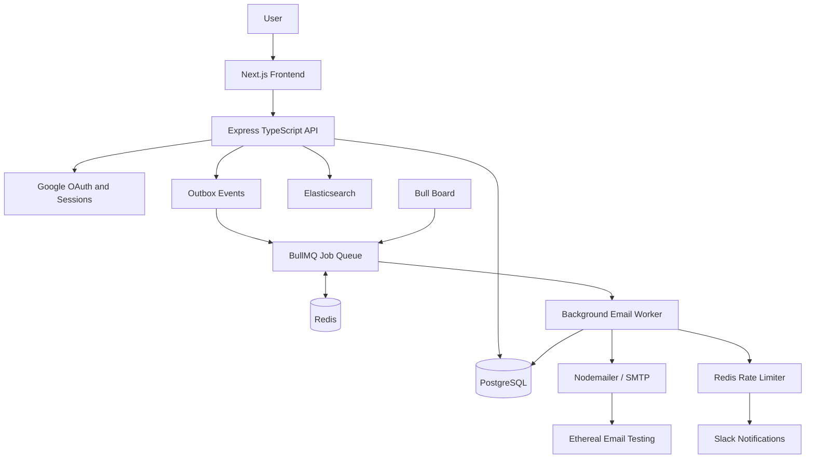

# ReachInbox — Full-Stack Email Job Scheduler

A full-stack email scheduling application that allows users to upload recipient lists, configure email campaigns, schedule messages, monitor email activity, search email records, and receive Slack notifications for rate-limit events.

The application uses a TypeScript and Express backend, BullMQ and Redis for background job processing, PostgreSQL for persistent application data, and a Next.js frontend.

---

## Table of Contents

- [Overview](#overview)
- [Key Features](#key-features)
- [Architecture](#architecture)
- [Technology Stack](#technology-stack)
- [Project Structure](#project-structure)
- [Prerequisites](#prerequisites)
- [Getting Started](#getting-started)
- [Environment Configuration](#environment-configuration)
- [Running the Application](#running-the-application)
- [Email Scheduling Workflow](#email-scheduling-workflow)
- [Rate Limiting and Concurrency](#rate-limiting-and-concurrency)
- [Reliability and Recovery](#reliability-and-recovery)
- [Authentication and Integrations](#authentication-and-integrations)
- [API Reference](#api-reference)
- [Testing](#testing)
- [Troubleshooting](#troubleshooting)
- [Demo Checklist](#demo-checklist)
- [Security](#security)

---

## Overview

ReachInbox is designed to schedule and process email campaigns asynchronously without blocking the main application.

Users can upload recipient lists, configure campaign timing, and track scheduled and sent emails through a dashboard. Background workers process eligible email jobs while Redis coordinates queue operations and rate limiting.

The application also supports email testing, Google OAuth, Slack notifications, Elasticsearch integration, and Bull Board for queue monitoring.

### Objectives

- Schedule email jobs for future execution.
- Process emails asynchronously using background workers.
- Persist campaign and email records.
- Enforce configurable sending limits.
- Coordinate background workers.
- Recover eligible pending work after interruptions.
- Monitor scheduled, sent, and failed operations.
- Search email records.
- Provide operational visibility into background jobs.

---

## Key Features

### 1. Campaign Management

- Create email campaigns from recipient lists.
- Configure campaign start time.
- Configure the delay between email jobs.
- Configure the hourly sending limit.
- View campaign progress.
- Cancel campaigns where supported.

### 2. Recipient Management

- Parse recipient lists from supported CSV or TXT files.
- Validate recipient data before scheduling.
- Display recipient counts before campaign submission.
- Handle invalid input through validation errors.

### 3. Background Job Scheduling

- Use BullMQ and Redis for asynchronous job processing.
- Schedule jobs for future execution.
- Process eligible jobs through background workers.
- Configure worker concurrency.
- Persist campaign and email information in PostgreSQL.

### 4. Email Sending

- Use Nodemailer and SMTP for email delivery.
- Support Ethereal Email for development and testing.
- Record email activity for dashboard visibility.
- Provide email preview information where supported.

**Note:** Ethereal is intended for testing and previewing emails. It does not deliver test messages to real recipients' inboxes.

### 5. Rate Limiting

- Enforce a configurable hourly email limit.
- Coordinate rate-limit checks across workers using Redis.
- Defer eligible jobs when the configured quota is exhausted.
- Update scheduling information where implemented.
- Notify the configured Slack destination when a rate-limit event occurs.

### 6. Dashboard

- View scheduled email records.
- View sent email records.
- Inspect email details and previews.
- Monitor campaign progress.
- Search email records.
- Access supported campaign actions.

### 7. Authentication

- Google OAuth integration.
- Session-based authentication where configured.
- Development login support if enabled.

### 8. Slack Integration

- Connect a Slack account or destination through the implemented OAuth flow.
- Check connection status.
- Send test notifications.
- Receive notifications about configured operational events.

### 9. Email Search

- Integrate Elasticsearch for email search where configured.
- Provide an application-level search endpoint.
- Support fallback behavior where implemented.

### 10. Queue Monitoring

- Use Bull Board to inspect background queues.
- Monitor job states and processing activity.
- Investigate pending, active, completed, or failed jobs.

---

## Architecture

The application separates the user interface, API, persistent data, queue, and background email processing.



### Component Responsibilities

| Component | Responsibility |
|---|---|
| Next.js | User interface and dashboard |
| Express | HTTP APIs and application logic |
| PostgreSQL | Persistent campaign, email, and related application records |
| Prisma | Database access and schema management |
| BullMQ | Background and delayed job processing |
| Redis | Queue storage, coordination, and rate-limit state |
| Nodemailer | SMTP email transport |
| Ethereal | Development email testing and preview |
| Google OAuth | User authentication |
| Slack | Operational notifications |
| Elasticsearch | Email search, where configured |
| Bull Board | Queue inspection and monitoring |
| Vitest / Supertest | Automated testing |

The diagram describes the logical architecture. Actual data flows depend on the implementation.

---

## Technology Stack

### Backend

- Node.js
- TypeScript
- Express.js
- Prisma ORM
- PostgreSQL
- BullMQ
- Redis
- Nodemailer
- Ethereal Email
- Google OAuth
- Slack OAuth and notifications
- Elasticsearch
- Bull Board
- Zod
- Vitest
- Supertest

### Frontend

- Next.js
- React
- TypeScript
- Tailwind CSS
- Lucide icons
- Sonner notifications

### Development Tools

- Git and GitHub
- Docker Compose, if configured
- npm
- VS Code

---

## Project Structure

The following is a logical overview. Adjust it to match the actual files in the repository.

```text
ReachInbox/
├── backend/
│   ├── prisma/
│   │   └── schema.prisma
│   ├── src/
│   │   ├── routes/
│   │   ├── services/
│   │   ├── workers/
│   │   ├── queues/
│   │   ├── middleware/
│   │   └── ...
│   ├── tests/
│   ├── .env.example
│   └── package.json
│
├── frontend/
│   ├── src/
│   │   ├── app/
│   │   ├── components/
│   │   └── ...
│   ├── .env.example
│   └── package.json
│
├── docker-compose.yml
├── .gitignore
└── README.md
```

The backend and frontend are maintained as separate applications and have their own dependencies and environment configuration.

---

## Prerequisites

Install the following before starting:

- **Node.js:** A version supported by the project's dependencies.
- **npm:** Included with Node.js.
- **PostgreSQL:** Database service.
- **Redis:** Queue and rate-limit coordination.
- **Git:** Source control.
- **Docker Desktop:** Optional, if using the provided Docker Compose configuration.

Optional external integrations:

- Google OAuth credentials.
- Slack app credentials.
- Elasticsearch.
- SMTP credentials.

Ethereal may be used for development email testing if the application is configured to provision or use an Ethereal account automatically.

---

## Getting Started

### 1. Clone the Repository

```bash
git clone https://github.com/Sakshi947-s/ReachInbox-.git
cd ReachInbox-
```

If you already have the repository locally, open a terminal in the project root.

### 2. Install Backend Dependencies

```bash
cd backend
npm install
```

### 3. Install Frontend Dependencies

Open a second terminal in the project root:

```bash
cd frontend
npm install
```

### 4. Configure Environment Files

From the project root, use Windows Command Prompt:

```cmd
copy backend\.env.example backend\.env
copy frontend\.env.example frontend\.env.local
```

Alternatively, use PowerShell:

```powershell
Copy-Item backend/.env.example backend/.env
Copy-Item frontend/.env.example frontend/.env.local
```

Update the copied files with the required local configuration.

**Never commit real credentials, OAuth secrets, session secrets, or production environment files.**

### 5. Start Infrastructure Services

If the repository contains a working `docker-compose.yml` that defines the required services, run:

```bash
docker compose up -d
```

Check service status:

```bash
docker compose ps
```

If you are not using Docker, start PostgreSQL and Redis separately and configure their connection settings.

### 6. Prepare the Database

From the backend directory, run the database commands supported by the project's `package.json` and Prisma setup.

A typical Prisma development workflow is:

```bash
npx prisma generate
npx prisma migrate dev
```

Run migrations only when the configured database is available and the project has valid Prisma migration files.

If the project uses a different migration workflow, follow its existing scripts.

---

## Environment Configuration

The exact environment variable names are defined in:

- `backend/.env.example`
- `frontend/.env.example`

Copy these templates and configure the variables required by the implementation.

Common configuration categories include:

| Category | Purpose |
|---|---|
| Backend port | HTTP API port |
| Database URL | PostgreSQL connection |
| Redis URL | Queue and rate-limit connection |
| Session secret | Session security |
| Google client ID | Google OAuth |
| Google client secret | Google OAuth |
| Google callback URL | OAuth redirect |
| Slack client ID | Slack OAuth |
| Slack client secret | Slack OAuth |
| Slack callback URL | Slack OAuth redirect |
| Elasticsearch URL | Search service |
| SMTP configuration | Email transport, if required |
| Frontend API URL | Backend API base URL |

Use the **exact variable names in your existing environment templates and source code**. The categories above are explanatory, not a replacement for the actual configuration.

### Google OAuth

Configure the authorized redirect URI to match the backend callback route and local port.

For example, if the implementation uses:

```text
http://localhost:5000/api/auth/google/callback
```

register that exact URI with your Google OAuth application.

### Slack OAuth

Configure the Slack callback URI to match the actual route implemented in the backend.

For example, if the implementation uses:

```text
http://localhost:5000/api/slack/callback
```

use that URI in the Slack application configuration and the corresponding environment variable.

**Verify the callback route before registering it.** OAuth redirect URIs must match exactly.

---

## Running the Application

Start the services in the order required by your configuration.

### Terminal 1: Infrastructure

If using Docker Compose:

```bash
docker compose up -d
```

### Terminal 2: Backend API

```bash
cd backend
npm run dev
```

The API may be available at:

```text
http://localhost:5000
```

Confirm the actual port in the environment configuration.

### Terminal 3: Frontend

```bash
cd frontend
npm run dev
```

The frontend is typically available at:

```text
http://localhost:3000
```

### Background Worker

If the worker runs as a separate process, start it using the configured script.

For example:

```bash
cd backend
npm run worker
```

If the worker starts automatically with the backend, a separate command may not be required.

### Queue Dashboard

If Bull Board is mounted at `/admin/queues`, open:

```text
http://localhost:5000/admin/queues
```

The actual path depends on the backend configuration. Restrict access to this dashboard before exposing it outside local development.

---

## Email Scheduling Workflow

The high-level campaign workflow is:

1. The user opens the dashboard.
2. The user uploads a supported recipient file.
3. The application parses and validates the recipients.
4. The user configures the campaign start time, inter-email delay, and hourly sending limit.
5. The backend validates the request and persists campaign information.
6. Email jobs are created or dispatched through the configured queue workflow.
7. BullMQ and Redis manage job availability and delayed execution.
8. Background workers process eligible jobs.
9. The worker checks applicable sending limits.
10. The configured SMTP transport attempts to send the email.
11. The application updates the relevant email record and campaign progress.
12. The dashboard displays the available status and email details.

### Scheduling Controls

| Setting | Purpose |
|---|---|
| Campaign start time | Determines when campaign processing should begin |
| Inter-email delay | Spaces out eligible email jobs |
| Hourly limit | Caps sends within the configured hourly window |
| Worker concurrency | Controls how many jobs a worker can process concurrently |

The actual timing behavior depends on the queue configuration and scheduling logic in the backend.

---

## Rate Limiting and Concurrency

Rate limiting and concurrency address different problems.

### Rate Limiting

The hourly sending limit restricts how many email sends are permitted during the configured time window.

A distributed implementation can use Redis to coordinate quota checks across multiple workers.

When the quota is exhausted, eligible jobs should be deferred according to the application's rate-limit logic rather than discarded.

### Worker Concurrency

Concurrency determines how many jobs a worker can process at the same time.

Higher concurrency may improve throughput, but it does not replace rate limiting. A system can process multiple jobs concurrently while still enforcing an hourly sending quota.

### Inter-Email Delay

The inter-email delay spaces out scheduled email jobs. Its exact meaning—such as a delay between consecutive recipients or a campaign-wide scheduling interval—depends on the implementation.

### Rate-Limit Notifications

When a rate-limit event triggers the configured notification logic, the application can send an alert to the connected Slack destination.

Notification deduplication and delivery behavior depend on the implementation.

---

## Reliability and Recovery

ReachInbox uses persistent application data and background job processing to support recovery from interruptions.

Depending on the implemented workflow, reliability mechanisms may include:

- Persisting campaign and email records in PostgreSQL.
- Using BullMQ and Redis to manage scheduled jobs.
- Recording outbox events for work that needs queue dispatch.
- Retrying eligible jobs after transient failures.
- Recovering pending outbox events after a restart.
- Using stable job identifiers to reduce duplicate queue submissions.
- Updating email and campaign statuses during processing.

### Outbox Pattern

An outbox pattern can help coordinate database changes with queue dispatch:

1. Persist application changes and an outbox event in a database transaction.
2. Dispatch eligible outbox events to the queue.
3. Record dispatch progress.
4. Retry pending events after recoverable failures.

The exact guarantees depend on the transaction boundaries, worker logic, and recovery implementation.

### Delivery Guarantees

Queue-level job deduplication does not automatically guarantee exactly-once email delivery.

For example, an SMTP server may accept a message before the application records the successful result. If the process crashes at that point, a retry may send the message again.

Therefore, the system should be described as supporting persistent scheduling and recovery of eligible work—not as guaranteeing exactly-once delivery unless that guarantee has been specifically implemented and verified.

Redis persistence, PostgreSQL availability, SMTP behavior, retry policies, and recovery logic all affect system reliability.

---

## Authentication and Integrations

### Google OAuth

Google OAuth provides the configured sign-in flow.

The callback URL and credentials must match the application's OAuth configuration.

### Development Authentication

If enabled, the development login endpoint can simplify local testing. It should not be exposed as an unrestricted production authentication mechanism.

### Email Transport

Nodemailer connects the application to its configured SMTP transport.

Ethereal can be used to test email generation and inspect message previews without sending test emails to real recipients' inboxes.

### Slack

Slack integration can provide notifications about configured operational events, including rate-limit events.

The available connect, disconnect, status, and test-notification actions depend on the implemented routes.

### Elasticsearch

Elasticsearch can index and search email records. Search availability depends on the service being configured and the indexing workflow being operational.

### Bull Board

Bull Board provides a visual interface for inspecting BullMQ jobs and queue activity.

---

## API Reference

The following table lists representative endpoints documented for this project. **Verify each path and HTTP method against the actual Express router before treating this table as an exact API contract.**

| Method | Endpoint | Purpose |
|---|---|---|
| GET | `/api/health` | Basic health check |
| GET | `/api/health/ready` | Readiness check |
| GET | `/api/auth/google` | Begin Google OAuth |
| GET | `/api/auth/google/callback` | Handle Google OAuth callback |
| POST | `/api/auth/dev-login` | Development login, if enabled |
| GET | `/api/auth/me` | Retrieve the current user |
| POST | `/api/auth/logout` | End the session |
| POST | `/api/campaigns/parse-recipients` | Parse and validate recipients |
| POST | `/api/campaigns` | Create a campaign |
| GET | `/api/campaigns` | List campaigns |
| POST | `/api/campaigns/:id/cancel` | Cancel a campaign, if supported |
| GET | `/api/emails/scheduled` | Retrieve scheduled email records |
| GET | `/api/emails/sent` | Retrieve sent email records |
| GET | `/api/emails/search?q=...` | Search email records |
| GET | `/api/slack/status` | Check Slack connection status |
| POST | `/api/slack/disconnect` | Disconnect Slack, if supported |
| POST | `/api/slack/test` | Test Slack notification delivery |

Additional OAuth endpoints may exist for starting and completing the Slack authorization flow.

### Health Check

For example:

```bash
curl http://localhost:5000/api/health
```

The readiness endpoint may also check dependencies, depending on its implementation.

### Error Handling

Requests may fail because of:

- Invalid recipient data.
- Missing required configuration.
- Authentication or authorization errors.
- Unavailable database or Redis services.
- Rate-limit restrictions.
- SMTP errors.
- Search service failures.

Use the actual response body and server logs to diagnose failed requests.

---

## Testing

The backend uses Vitest and may use Supertest for HTTP endpoint testing.

Run the scripts defined in `backend/package.json`.

A common command is:

```bash
cd backend
npm test
```

If the project defines separate test, type-check, or build scripts, run those as well.

For example:

```bash
npm run build
```

Only run commands that actually exist in the relevant `package.json`.

### Areas to Test

- Recipient parsing and validation.
- Campaign creation.
- Scheduling and delayed jobs.
- Rate-limit behavior.
- Authentication and session handling.
- Google OAuth callback behavior.
- Slack integration behavior.
- SMTP transport behavior.
- Database and queue recovery.
- Health endpoints.
- Email status updates.
- Search behavior.

Document the test count and results from the latest successful test run. Do not rely on an old test count if the tests have changed.

---

## Troubleshooting

### Backend Does Not Start

- Check that backend dependencies are installed.
- Verify the backend environment file exists.
- Check the configured port.
- Review the terminal error message.

### Database Connection Fails

- Confirm PostgreSQL is running.
- Verify the database URL.
- Ensure the database exists.
- Run the project's configured Prisma setup and migrations.

### Redis Connection Fails

- Confirm Redis is running.
- Check the configured Redis URL.
- Verify that the backend and worker use the intended Redis instance.

### Emails Are Not Being Processed

- Check that the queue is available.
- Confirm that the worker is running, if it is a separate process.
- Inspect job states in Bull Board.
- Review rate-limit and retry behavior.
- Check the configured SMTP transport and backend logs.

### Ethereal Preview Is Missing

- Confirm the SMTP operation completed.
- Check where the application stores preview URLs or email metadata.
- Review backend logs for transport errors.

### OAuth Does Not Work

- Verify the client ID and secret.
- Confirm that the redirect URI matches exactly.
- Check session and cookie configuration.
- Review callback errors in the backend logs.

### Slack Notifications Do Not Arrive

- Verify Slack OAuth configuration and the selected destination.
- Check the configured callback URL.
- Confirm the required Slack permissions.
- Review the response from Slack and backend logs.

### Search Does Not Work

- Confirm Elasticsearch is running if required.
- Verify the configured service URL.
- Check whether records have been indexed.
- Review the application's search fallback behavior, if implemented.

---

## Demo Checklist

A short demonstration can follow this sequence:

1. Start the required infrastructure services.
2. Start the backend and frontend.
3. Sign in using the configured authentication flow or supported development login.
4. Open the campaign composition screen.
5. Upload a small sample recipient file.
6. Show the parsed recipient count.
7. Configure a start time, inter-email delay, and hourly limit.
8. Create a campaign.
9. Show scheduled email records and campaign progress.
10. Demonstrate email processing with the configured test transport.
11. Open an email record or preview, if available.
12. Demonstrate search and queue monitoring.
13. If Slack is configured, demonstrate its connection status or a test notification.
14. Explain the rate-limit and recovery workflow.

Use test recipients and Ethereal for a safe demonstration. Do not expose real recipient data, OAuth secrets, session tokens, or private environment configuration.

---

## Security

- Keep credentials in local environment files or a secure secrets manager.
- Never commit real `.env` files.
- Keep development-only authentication disabled in production.
- Restrict access to Bull Board.
- Validate uploaded recipient files and request payloads.
- Protect OAuth sessions and callback handling.
- Avoid logging passwords, access tokens, or other secrets.
- Review rate limits and retry behavior before deployment.

---

## Future Improvements

Potential improvements include:

- More detailed campaign analytics.
- Enhanced retry policies and dead-letter handling.
- Stronger monitoring and structured logging.
- Additional email provider integrations.
- More extensive end-to-end tests.
- Improved delivery reconciliation and duplicate-send handling.
- Deployment automation and production observability.

---
